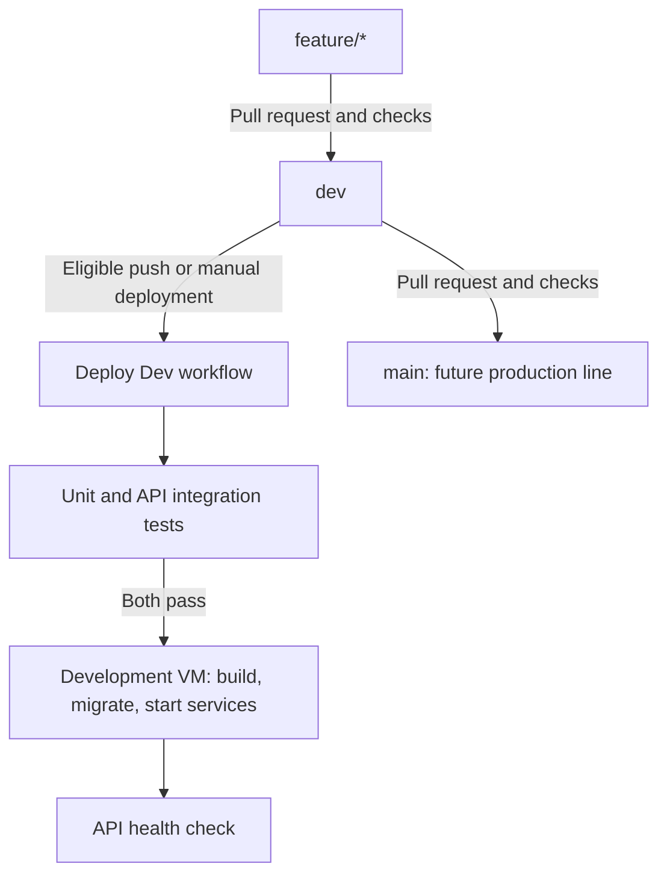
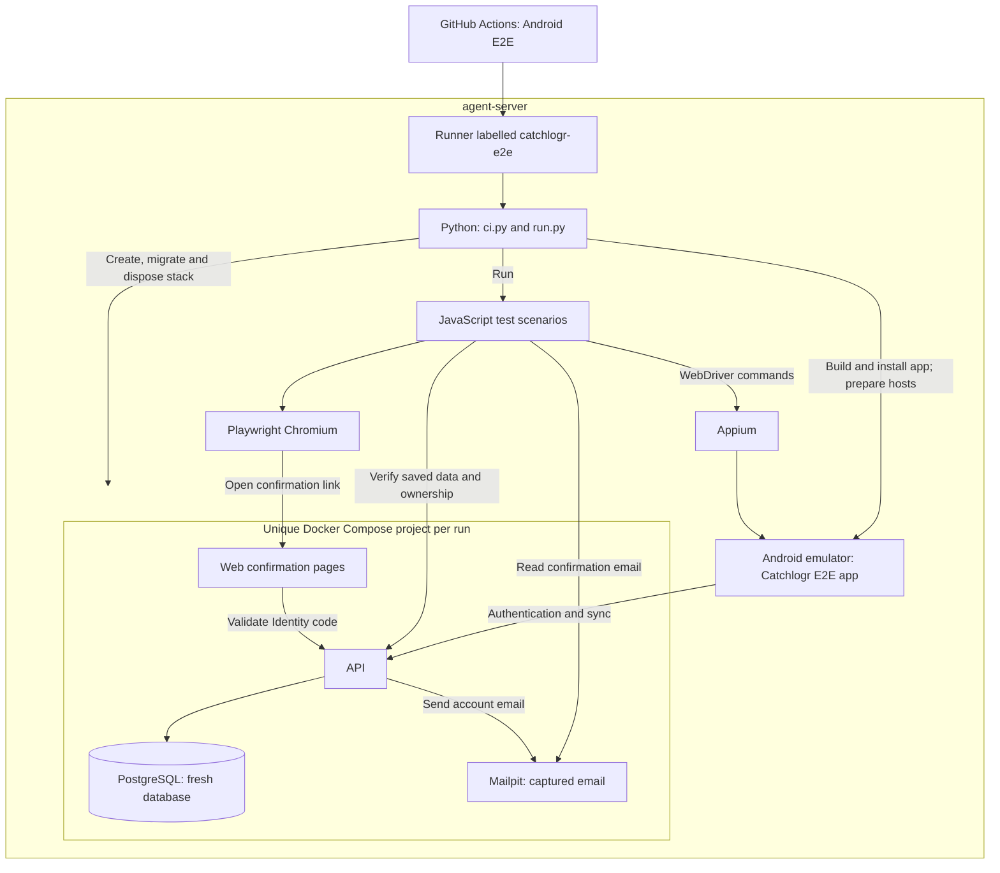

# CI/CD

Catchlogr uses three GitHub Actions workflows. The ordinary pull-request test and
documentation jobs use a self-hosted Linux runner labelled `self-hosted`, `linux`, `x64`, and
`catchlogr`.

## Branch flow



The CI workflow runs for pull requests targeting `dev` or `main`. A dedicated
job rejects a pull request to `main` unless its source branch is `dev`.

## Pull-request CI

`.github/workflows/ci.yml` currently runs:

1. `unit-tests`
   - restores `tests/Catchlogr.Tests`;
   - builds it in Release; and
   - runs it without rebuilding.
2. `integration-tests`
   - restores `tests/Catchlogr.Api.IntegrationTests`;
   - builds it in Release; and
   - runs it without rebuilding.
3. `mobile-tests`
   - restores and builds the plain net10.0 Catchlogr.Mobile.Tests in Release;
   - runs it without rebuilding on Linux, with no MAUI workload.
4. `documentation`
   - runs scripts/validate-docs.ps1 with pwsh;
   - runs the dependency-free validation helper tests with pwsh using disposable
     Git fixtures and fake application runners.
5. `validate-main-source`
   - runs only for a pull request targeting `main`;
   - requires the source branch to be `dev`.

The API integration suite replaces PostgreSQL with EF Core InMemory, Resend with
an in-memory sender, and photo storage with an isolated temporary directory. CI
therefore does not require a PostgreSQL service.

The self-hosted runner supplies the .NET SDK; its jobs report dotnet --info
instead of installing an SDK. Mobile tests reference Mobile.Core; The ordinary CI workflow does not
build the MAUI shell or validate device UI. See [Validation](VALIDATION.md) for
local commands and test limitations.

## Android E2E CI

`.github/workflows/e2e.yml` adds a separate `android-e2e` job for pull requests to
`dev`/`main` whose source repository is this repository, plus manual dispatch.
Fork pull requests are skipped. It uses only the dedicated `catchlogr-e2e` label,
a 35-minute timeout, read-only repository permissions, and host-wide workflow
concurrency without cancelling an active run. It does not change deployment
conditions or make E2E a required branch check.

The intended machine is **agent-server**, alongside its emulator/Appium tooling.
The existing **LXC runner** retains its `catchlogr` label and ordinary CI/deployment
work. The deployed development VM and developer laptop are not E2E backends.
The workflow provisions disposable backend services and invokes
`tests/e2e/ci.py`; [Validation](VALIDATION.md#isolated-authentication-and-sync-e2e)
owns prerequisites, scenarios, ports, isolation, and local commands.

The following is the test topology, not the shared development deployment.
Appium controls the emulator; the scenario scripts also inspect API results and
open the real Web confirmation page in Chromium. Backend services are disposable.



The host owner installed and registered the dedicated runner on 2026-11-13;
GitHub reported it online. Registration lets repository workflows execute code
on that VM. The installer is included at `tests/e2e/install_runner.py`. It uses
an authenticated GitHub CLI with repository admin access, fetches GitHub's runner
download metadata, verifies SHA-256, and registers `catchlogr-agent-server-e2e`
with `--no-default-labels --labels catchlogr-e2e`. Omitting default labels prevents
ordinary generic `self-hosted` jobs from routing to this host. It writes runner
credentials outside the checkout and installs the user service
`catchlogr-e2e-runner.service`. It never replaces an existing registration.

For a new installation, run on agent-server with Python 3.12+ and an authenticated `gh`:

```sh
python3 tests/e2e/install_runner.py
systemctl --user status catchlogr-e2e-runner.service
loginctl show-user "$USER" -p Linger
```

The user manager must remain active after logout (Linger=yes), and the runner
user needs Docker access, KVM access, and the Android environment at
`~/.local/share/catchlogr-android/env.sh`. The installer is specific to this
repository and existing Linux x64 host. Stop job intake with
`systemctl --user stop catchlogr-e2e-runner.service`. Removing the runner also
requires removing its registration in repository Settings → Actions → Runners.

Each job provisions Node.js 24, installs the locked Playwright client/browser,
loads the existing Android host environment, and builds the real E2E APK. The
workflow selects the host SDK and MAUI workload under `~/.dotnet` and adds
`~/.local/bin` to PATH so the service does not depend on an interactive shell. The wrapper reuses live
emulator/Appium processes or starts them when absent. It stops only processes it
owns. The backend runner disposes the generated stack on success/failure and
interrupt. Routine uploaded artifacts contain result JSON and redacted hierarchy;
screenshots and raw host/WebDriver logs stay local. Retention is seven days.

To request videos, open **Actions → Android E2E → Run workflow**, select the
branch, and enable **Record Android and email confirmation videos**. The checkbox
is off by default and automatic pull-request runs never enable recording. GitHub
must have this workflow on the default branch (`main`) before offering the manual
run menu; once available, the branch selector can target `dev`.
After the run, download `android-e2e-videos` from its Artifacts section. Requested
videos are uploaded even on test failure when available, with seven-day retention.
The video artifact contains unredacted disposable test UI data; see
[Validation](VALIDATION.md#isolated-authentication-and-sync-e2e) for recording scope
and local commands.

PR #16 triggered the workflow and the dedicated runner accepted its job. Initial
attempts exposed missing Node.js and user SDK paths in the service environment;
the workflow now configures these explicitly. A complete passing Actions run
has not yet been verified.

## Development deployment

`.github/workflows/deploy-dev.yml` runs on pushes to `dev` unless all changed
paths match its `paths-ignore` list. This covers README.md, docs/**, scripts/**,
AGENTS.md and CLAUDE.md at any depth, .agents/skills/**, .claude/commands/**,
.github/copilot-instructions.md, and .github/instructions/**. Instruction-only
pushes therefore skip deployment. A mixed push containing application, build,
Compose, or workflow changes still triggers it. The rest of .github/** is not
excluded. See [GitHub path-filter semantics](https://docs.github.com/en/actions/reference/workflows-and-actions/workflow-syntax#onpushpull_requestpull_request_targetpathspaths-ignore).

Pull-request CI has no path exclusions and continues validating instructions,
skills, and documentation. Manual dispatch remains available independently of
push path filters; that trigger has no branch guard in the workflow. The remote
script always deploys origin/dev.

The deployment workflow gates on its own backend test jobs, not Mobile or
documentation checks. It has the following dependency chain:

```text
unit-tests ───────┐
                  ├──> deploy
integration-tests┘
```

The deployment job:

1. copies `deploy/docker/compose.dev.yml` to
   `/opt/catchlogr/compose.yml` on the development server;
2. connects to the server over SSH;
3. updates `/opt/catchlogr/app` to `origin/dev`;
4. builds API and Web container images;
5. runs the Compose `migrate` profile;
6. starts/updates the stack; and
7. verifies `https://dev-api.catchlogr.com/health` with retries.

The GitHub Environment is `development` with URL `https://dev.catchlogr.com`.
The workflow concurrency group `catchlogr-dev` allows only one development
deployment at a time and does not cancel an in-progress deployment.

## Development server layout

```text
/opt/catchlogr/
├── compose.yml          copied from the repository
├── .env                 server-owned secrets and configuration
├── app/                 repository checkout
└── data/photos/         persistent private photo data
```

PostgreSQL data lives in the Docker named volume `postgres_data`.

The server-owned `.env` supplies at least:

- `POSTGRES_DB`, `POSTGRES_USER`, and `POSTGRES_PASSWORD`;
- `LocationSearch__LocationIQ__ApiKey`;
- `Email__ApiKey`, `Email__FromAddress`, `Email__FromName`, and
  `Email__PublicWebBaseUrl`.

Secrets, PostgreSQL files, and private photos must not be copied back into Git.

## Failure behavior

- Test failures prevent the deployment job from starting.
- A failed file copy or SSH connection leaves the running stack unchanged.
- A failed source update, image build, or migration stops the remote script
  because it uses `set -e`.
- Compose builds do not replace running containers until `docker compose up -d`.
- A failed health check marks the workflow failed but does not automatically roll
  back containers or database migrations.

Database migrations must therefore remain forward-compatible with the currently
running application during deployment. Production deployment needs an explicit
backup and rollback strategy before it is enabled.

## Useful server commands

```bash
cd /opt/catchlogr
docker compose ps
docker compose logs -f --tail 100 api
docker compose logs -f --tail 100 web
docker compose logs -f --tail 100 db
docker compose --profile tools run --rm migrate
curl --fail https://dev-api.catchlogr.com/health
```

## Repository and environment ownership

Safe to version:

- Compose and Dockerfiles;
- workflow definitions;
- environment-variable names and safe templates;
- health-check and migration commands.

Owned outside Git:

- runner/server SSH credentials;
- provider and email keys;
- database passwords;
- private photo content;
- environment protection and branch rules.

The workflow files are the executable source of truth. Update this document in
the same pull request whenever job names, triggers, deployment paths, or service
dependencies change.
