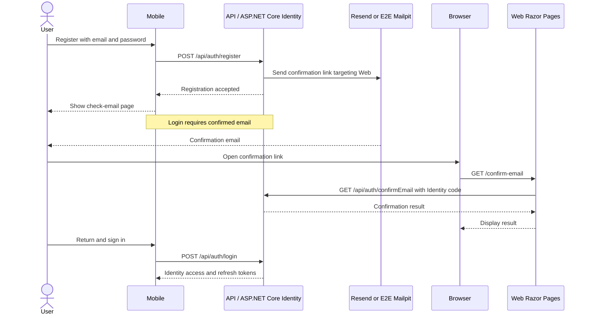

# Identity email and password recovery

The API uses ASP.NET Core Identity Minimal APIs and Resend for account email.
The default policy requires email confirmation before login. Access and refresh
tokens use Identity's bearer scheme; do not assume JWT format.

## Configuration

The API defaults to Resend and validates these Email settings at startup:

| Setting | Purpose |
| --- | --- |
| ApiKey | Resend sending key |
| FromAddress | Valid sender on your verified domain |
| FromName | Sender display name |
| PublicWebBaseUrl | Externally reachable absolute HTTPS Web origin |

Use the [README setup commands](../README.md#2-configure-api-secrets).
Environment variables use double underscores, such as Email__PublicWebBaseUrl.
Local Web is https://localhost:7056; development Web is https://dev.catchlogr.com.
Use the Web origin, not the API origin. Mobile backend selection does not
configure email links. A local link works only on a device that can reach it.

## Captured email for E2E

The dedicated E2E stack sets `Email:Provider=Mailpit` and
`Email:MailpitBaseUrl=http://mailpit:8025`. This transport is accepted only when
the API host environment is exactly `E2E`; Development and Production reject it.
The inbox origin must be HTTP loopback or the `mailpit` container, with no
credentials, path, query, or fragment. Resend remains the default provider and
still requires `ApiKey`; Mailpit does not require a Resend key.

Both transports use the same `IdentityEmailSender` for content and Web link
rewriting. Email confirmation, Identity token validation, password rules, and
bearer authentication stay enabled. No account seed or confirmation bypass is
needed. Provider response bodies and account-action URLs are not logged by the
sender. See [E2E setup and execution](VALIDATION.md#isolated-authentication-and-sync-e2e)
for the disposable database, inbox, browser, and Android runner.

## Flow

This sequence shows successful registration and confirmation. Resend delivers
normal account email; the isolated E2E environment substitutes Mailpit without
changing Identity validation. The browser can be on a different device from Mobile.

1. Registration sends a confirmation link and opens Mobile's check-email page,
   which can resend the message.
2. IdentityEmailSender rewrites account-action links to Web Razor Pages.
3. The user confirms via Web and returns to Mobile to sign in.
4. Forgot password sends a reset link without revealing whether the account
   exists; the email also includes a code for the mobile reset form.
5. The Web reset page sends the email, reset code, and password to the API over
   HTTPS; the API validates the Identity code and password rules.

Web uses IIdentityApiClient, not database access. It sets Referrer-Policy to
no-referrer to limit account-action URL leakage. Keep codes and tokens out of logs.

## Password policy

The API enforces the same policy for registration (`POST /api/auth/register`),
password reset (`POST /api/auth/resetPassword`), and authenticated password changes
(`POST /api/auth/manage/info`, using `oldPassword` and `newPassword`):

- New passwords contain 15–128 Unicode code points, including spaces and Unicode.
  Whitespace-only values and malformed UTF-16 are rejected. Non-BMP characters
  count once. No uppercase, lowercase, digit, symbol, or distinct-character mix
  is required.
- Passwords are preserved exactly: no trimming, normalization, or truncation.
  Canonically equivalent Unicode strings can therefore be different passwords.
- A bundled common/compromised-password blocklist rejects complete values using
  ordinal case-insensitive comparison. It does not reject words within a phrase.
- Complete values based on `catchlogr`, the account email, or its local part are
  also rejected, including an optional `password` suffix, optional trailing digits,
  and trailing `!`, `.`, or `?`. This is a focused predictable-value check, not a
  strength score.
- There is no scheduled password expiration. Existing passwords remain usable
  until changed; the policy is applied when a password is set, not during login.

The bundled list is a limited snapshot, not a lookup of every breached password.
No password or password hash is sent to an external provider during validation.
The existing Identity password hasher, email-confirmation requirement, and account
lockout (five failed attempts, 15 minutes) remain in use. Account lockout is not
HTTP endpoint rate limiting.

Changing or resetting a password invalidates previously issued refresh tokens
through Identity's security stamp. Already issued bearer access tokens can remain
usable until their configured 30-minute expiry; password changes do not provide
immediate access-token revocation.

Mobile registration/reset and the Web reset page display policy guidance and map
the API codes `PasswordInvalidLength`, `PasswordBlocklisted`, and
`PasswordPredictable` to safe messages. Unknown validation failures remain generic;
raw response text is not displayed. Mobile password fields and the Web reset form
offer visibility controls and do not disable paste. Web declares
`autocomplete="new-password"`; native autofill and keyboard behavior need device
verification. Login accepts existing passwords without applying new-password rules.

### Blocklist source and maintenance

The server embeds [common-passwords.txt](../src/Catchlogr.Infrastructure/Identity/PasswordBlocklist/common-passwords.txt),
derived on 2026-10-23 from SecLists'
[one-million common passwords](https://github.com/danielmiessler/SecLists/blob/master/Passwords/Common-Credentials/xato-net-10-million-passwords-1000000.txt).
The snapshot contains 10,898 entries after retaining source values of 15–128
UTF-16 units and sorting/deduplicating with PowerShell `Sort-Object -Unique`.
The downloaded source text, encoded as UTF-8, had SHA-256
`424A3E03A17DF0A2BC2B3CA749D81B04E79D59CB7AEEC8876A5A3F308D0CAF51`.
The upstream [MIT license](../src/Catchlogr.Infrastructure/Identity/PasswordBlocklist/LICENSE.txt)
is retained alongside it.

Review this snapshot before production release and during authentication security
reviews. To update, download the same upstream file over HTTPS, split on newlines,
remove line-ending carriage returns only, retain entries in the documented range,
sort/deduplicate, and write UTF-8 without a BOM. Do not trim password whitespace.
Review upstream provenance/license and the resulting diff, update the date/count/hash
above, and run password-policy unit/API tests. The list is deployed with the API;
updates require a new build. Never add real users' passwords to this file.

## Verification

Use the [validation guide](VALIDATION.md): API integration tests exercise real
Identity confirmation/reset tokens with a capturing email sender; Web behavior
is covered in Catchlogr.Tests and Mobile flows in Catchlogr.Mobile.Tests.
Password-policy coverage includes length boundaries, Unicode, blocklisted and
account-derived values, all three password-setting routes, rejected-reset recovery,
existing-password compatibility, and safe client error mapping. Manually check
visibility controls, paste, and password-manager autofill on target devices and
the Web reset form before release.
These checks do not prove Resend delivery. When changing delivery/configuration,
perform a separate smoke check using the configured verified sender and confirm
the recipient can reach Web and complete the action.
